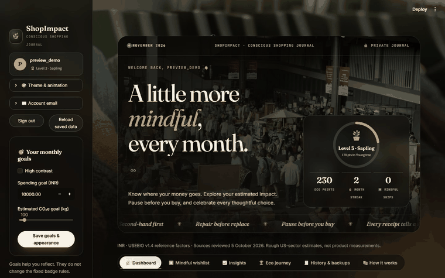
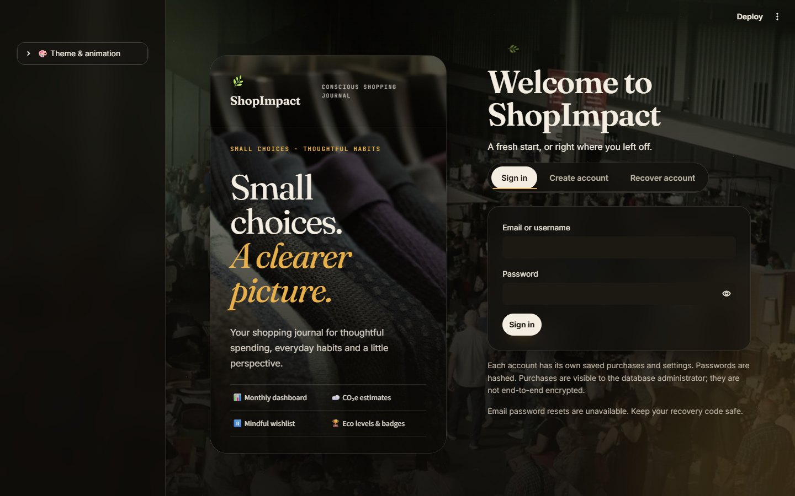
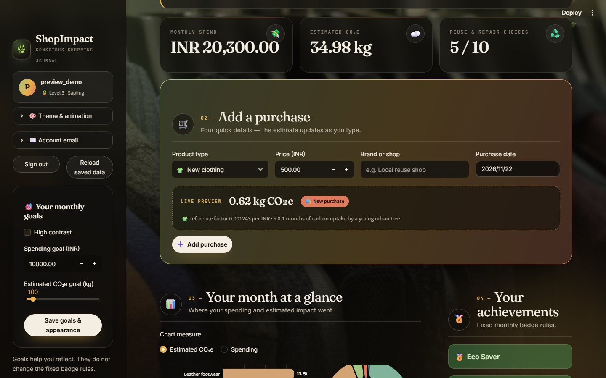
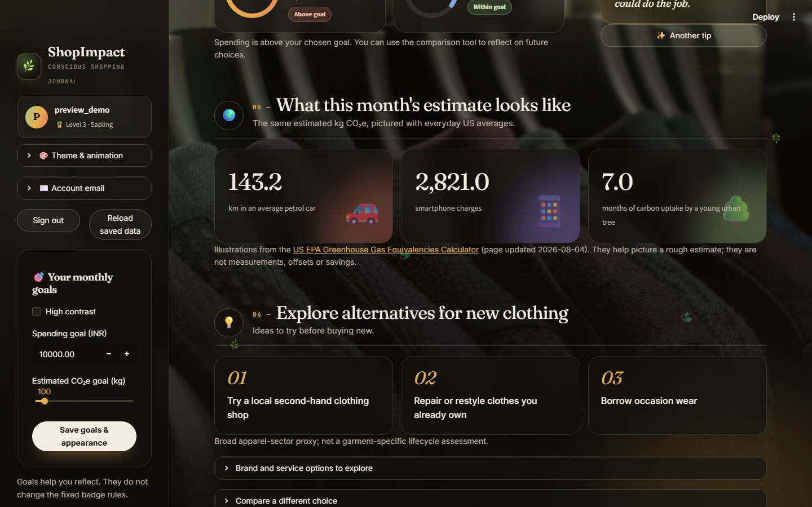
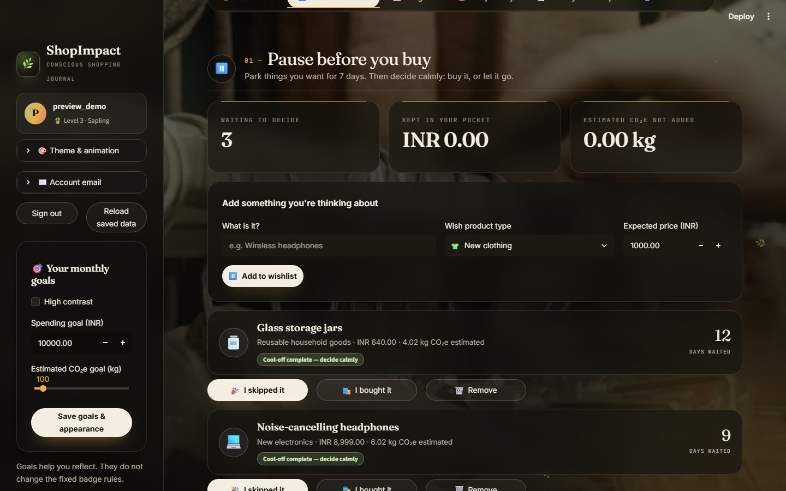
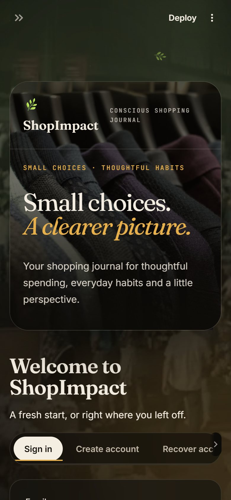
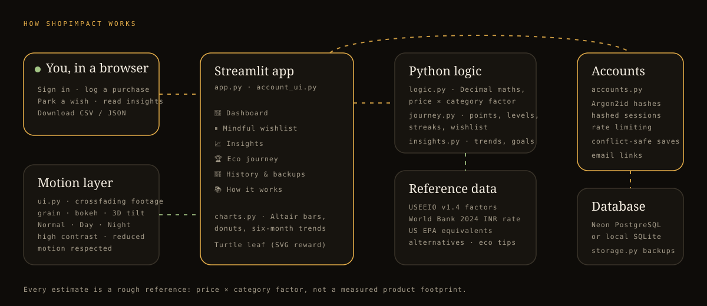
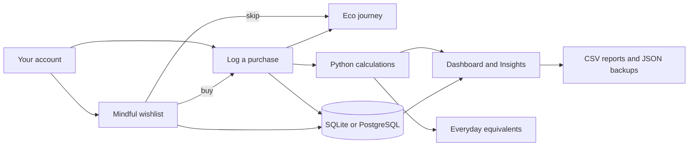

<div align="center">



<a href="https://shopimpact-duy7hphexgoshhqfexfmkt.streamlit.app/">
  
</a>

<p>
  <a href="https://shopimpact-duy7hphexgoshhqfexfmkt.streamlit.app/"></a>
</p>

<p>
  <a href="https://github.com/kavin-beep/ShopImpact-KavinK-1000527/actions/workflows/tests.yml"></a>
  
  
  
  
  
  
</p>

**🌐 Live app → [shopimpact-duy7hphexgoshhqfexfmkt.streamlit.app](https://shopimpact-duy7hphexgoshhqfexfmkt.streamlit.app/)**

<sub>
<a href="https://canva.link/v8iiqeb2k0bxb1g">Canva deck (21 slides)</a> ·
<a href="output/presentation/ShopImpact_Vibrant_Deck.pptx">PowerPoint</a> ·
<a href="output/pdf/ShopImpact_10_Page_Explanation.pdf">10-page guide</a> ·
<a href="#-run-it-locally">Run locally</a>
</sub>

</div>

---

## 🎬 A quick walk through

<div align="center">
  
  <br/><sub>Home · add a purchase · your month at a glance · everyday equivalents · mindful wishlist · insights · eco journey · history · Night theme · sign-in</sub>
</div>

---

## 🛍️ What is ShopImpact?

**ShopImpact** turns a purchase list into a calm, cinematic habit journal. You record what you buy, see where your money
goes, picture a rough emissions estimate, pause before buying, and celebrate reuse and repair. It implements
**Scenario 1** of the Year 1 Python Programming assessment.

> **An estimate, with a clear purpose.** CO₂e means carbon dioxide equivalent. ShopImpact estimates impact as
> **price × category factor**. It does not measure a specific product's actual emissions.

| Built with | Persistence | Checks | Release status |
| :---: | :---: | :---: | :---: |
| Python 3.12 · Streamlit · Altair | SQLite / Neon PostgreSQL | 94 tests passed locally · 22 Nov 2026 | Live on Streamlit Cloud |

---

## ✨ Highlights

### 🎨 Cinematic "Conscious Market Journal" design
- **Living background:** slow crossfades between second-hand market, clothes-rack, produce-stall and forest footage, with film grain and warm WebGL bokeh. It is injected once into the page, so it keeps looping across every click; a watchdog restarts stalled clips and a still gradient sits underneath, so the screen never goes black.
- **Video hero:** a masked serif headline ("A little more *mindful*, every month."), a level orb that draws itself, counting stats and a scrolling ticker of habits.
- **Editorial details:** dark glass panels, Fraunces serif headlines, mono kickers, numbered section headings, a pill tab index, gentle 3D card tilt and an earthy chart palette.
- **Themes for every mood:** **Normal** (natural footage), **Day** (warm golden grade with sun and clouds) and **Night** (blue-graded footage, crescent moon and falling stars).
- **Respectful motion:** turning off *Animated scenery*, or the device's reduced-motion setting, removes the video and animations. **High contrast** switches to black, white and yellow with no footage.

### 🧾 A shopping journal you can trust
- Product type (with icons), brand or shop, price and date, plus a **live receipt-style estimate** that shows the kg CO₂e, a reuse/new tag and an everyday equivalent as you type.
- A month dashboard with a **month-in-a-sentence** summary, spending, estimated kg CO₂e, category bars and donut, and animated **goal rings**.
- Search, month and category filters, sorting by date, price or impact, editing, deletion, filtered CSV downloads and JSON backup and restore.

### ⏸️ Habits, not guilt
- **Mindful wishlist:** park something for a 7-day cool-off, then skip it (+25 eco points, money "kept in your pocket") or buy it (it becomes a purchase with a fresh estimate).
- **Eco journey:** eco points, five levels from *Seedling* to *Forest keeper*, a reuse and repair streak and seven lifetime milestones. Points never change the fixed badge rules.
- **Everyday equivalents:** each month's estimate pictured as car kilometres, smartphone charges and tree-months using US EPA factors.
- **Ideas before buying:** category alternatives, named reuse and repair options with official links, rotating tips and a Turtle-drawn leaf reward.

### 🔐 Private accounts
- Email-or-username sign-in, recovery codes, optional email verification and reset links.
- Salted **Argon2id** password hashes, hashed sessions, rate limiting and protection against conflicting edits in two tabs.

---

## 🖼️ Screens

<table>
  <tr>
    <td width="50%"><br/><sub><b>Home</b> — video hero, level orb, counting stats</sub></td>
    <td width="50%"><br/><sub><b>Sign in</b> — video cover and account tabs</sub></td>
  </tr>
  <tr>
    <td><br/><sub><b>Add a purchase</b> — KPIs and a live receipt-style estimate</sub></td>
    <td><br/><sub><b>Your month at a glance</b> — bars, donut and badges</sub></td>
  </tr>
  <tr>
    <td><br/><sub><b>Equivalents and alternatives</b> — car km, phone charges, tree-months</sub></td>
    <td><br/><sub><b>Mindful wishlist</b> — 7-day cool-off, skip or buy</sub></td>
  </tr>
  <tr>
    <td><br/><sub><b>Insights</b> — six-month trend and category mix</sub></td>
    <td><br/><sub><b>Eco journey</b> — level, points, milestones</sub></td>
  </tr>
  <tr>
    <td><br/><sub><b>History and backups</b> — search, filter, export</sub></td>
    <td><br/><sub><b>Night theme</b> — moon, stars, blue-graded footage</sub></td>
  </tr>
</table>

<details>
<summary><strong>📱 Mobile</strong></summary>
<br/>
<div align="center"></div>
</details>

<sub>Screenshots use fictional purchases in an isolated local test account.</sub>

---

## ⚙️ How it works

<div align="center"></div>



### 📐 Data and calculations

- **Emission factors:** final **USEEIO Supply Chain GHG Emission Factors v1.4.0** (Cornerstone Sustainability Data Initiative, October 2025), IPCC AR6 warming potentials and 2024 USD prices. INR factors use the World Bank 2024 annual-average exchange rate. Values, source rows, mappings and URLs live in `data/emission_sources.json` and `data/product_catalog.json`.
- **Everyday equivalents:** US EPA Greenhouse Gas Equivalencies Calculator factors (page updated 4 August 2026): 3.93 × 10⁻⁴ t CO₂e per average petrol-car mile, 1.24 × 10⁻⁵ t CO₂ per smartphone charge and 0.060 t CO₂ per urban tree seedling per year (`data/equivalents.json`). They picture the estimate; they are not measurements, offsets or savings.
- **Honest limits:** these are **rough reference estimates**. US sector averages, broad category mappings, a fixed historical exchange rate and unadjusted prices are not a validated India-specific footprint. New and reused versions use the same factor; no unsupported reuse discount is invented. See the [methodology and migration policy](docs/2026-update.md). Existing purchases keep their stored estimates until recalculated in *How it works*.

---

## 🧭 Pages

| Tab | What you do there |
| --- | --- |
| 🌿 **Dashboard** | Pick a month, read the month in a sentence, add a purchase, see charts, goal rings, badges, equivalents and alternatives |
| ⏸️ **Mindful wishlist** | Park a want for 7 days, then skip it or buy it |
| 📈 **Insights** | Six-month trend, category mix, average purchase, goal balance and change from the previous month |
| 🏆 **Eco journey** | Level, eco points breakdown, lifetime milestones and monthly badges |
| 🧾 **History & backups** | Search, filter, sort, edit, delete, export CSV, and back up or restore JSON |
| 📚 **How it works** | Assumptions, factor table, privacy notes and estimate recalculation |

The sidebar holds your account, **Theme & animation**, account email, monthly spending and CO₂e goals, and high contrast.

---

## 🚀 Run it locally

Clone the repository, open the folder in VS Code and run these in its PowerShell terminal:

```powershell
git clone https://github.com/kavin-beep/ShopImpact-KavinK-1000527.git
cd ShopImpact-KavinK-1000527
py -3.12 -m venv .venv
.\.venv\Scripts\python.exe -m pip install -r requirements.txt --no-cache-dir
.\.venv\Scripts\python.exe -m streamlit run app.py --server.address 127.0.0.1
```

Open the URL printed in the terminal (normally http://localhost:8501). Create an account, save the recovery code
privately and sign in. Accounts start empty; no demo purchases are loaded. Refreshing the page signs you out but keeps
your saved purchases, and sessions expire after 12 hours. VS Code tasks and a *Run ShopImpact* debug configuration are
included (they need Microsoft's Python and Python Debugger extensions).

**Turtle reward artwork**

```powershell
.\.venv\Scripts\python.exe tools/draw_rewards.py
.\.venv\Scripts\python.exe tools/draw_rewards.py --preview
```

The default command uses `turtle.TNavigator` with an SVG pen adapter. `--preview` uses `turtle.Turtle` and needs a
working Tk. The app shows the generated SVG when a qualifying choice exists; it is not a live browser Turtle animation.

---

## ☁️ Deploy on Streamlit Community Cloud

1. Fork or push this repository to GitHub and create an app on [share.streamlit.io](https://share.streamlit.io) with `app.py` as the entry point.
2. In the app's **Secrets**, add `SHOPIMPACT_PUBLIC = true` and `SHOPIMPACT_DATABASE_URL` for a persistent PostgreSQL database (see [`.streamlit/secrets.example.toml`](.streamlit/secrets.example.toml) and the [Neon walkthrough](docs/neon-setup.md)).
3. Optional email delivery is described in the [Gmail setup guide](docs/email-setup.md). Full steps are in [deployment instructions](docs/deployment.md).

Neon PostgreSQL was connected and verified on 2 October 2026: registration, login, account isolation, persistence across
new connections, conflicting-save protection and logout passed. The public sign-in page has been checked in the
browser. Full account workflows on the deployed app, redeployment persistence and provider backup restoration remain
pending verification.

---

## 🔒 Storage and privacy

- Without hosted settings, accounts are stored in `personal_data/shopimpact.db`, which is excluded from Git. Local SQLite accounts are not migrated automatically; export purchases before switching and restore them into a hosted account.
- Each account has isolated purchases and settings. Passwords use salted Argon2id hashes; session and recovery tokens are stored as hashes. Five failed login or recovery attempts block that identifier for 15 minutes. Recovery rotates the code and revokes previous sessions. The database administrator can access purchase data; it is not end-to-end encrypted.
- Purchases save automatically on add, edit, delete and restore. Wishlist items save in the account's settings, alongside goals; skipped items never become purchases. JSON backups exclude credentials, sessions, settings and the wishlist. Imports accept up to 1,000 records and 2 MB.
- New registrations need a unique email address; existing accounts can add one in the sidebar's **Account email** panel. Verification and reset links expire, work once and are invalidated by relevant account changes. Gmail delivery is awaiting private sender setup. Google OAuth sign-in is not implemented.

---

## 🧪 Testing

```powershell
.\.venv\Scripts\python.exe -m unittest discover -s tests -v
```

94 automated tests pass (22 November 2026), and every push and pull request runs the suite on GitHub Actions. Tests use
disposable databases and never write to real accounts. See [test evidence](docs/testing.md).

| Test file | What it checks |
| --- | --- |
| [tests/test_logic.py](tests/test_logic.py) | Decimal rounding, price and date validation, factor provenance, summaries and badge rules |
| [tests/test_insights.py](tests/test_insights.py) | Six-month trends, month shifting, goal balance and history filters |
| [tests/test_journey.py](tests/test_journey.py) | Eco points, levels, streaks, milestones, EPA equivalents and the wishlist lifecycle |
| [tests/test_accounts.py](tests/test_accounts.py), [tests/test_account_service.py](tests/test_account_service.py) | Registration, hashing, isolation, recovery, rate limiting and conflicting saves |
| [tests/test_app.py](tests/test_app.py) | Real Streamlit flows: sign-in, themes, add/edit/delete, insights, wishlist skip/buy and backups |
| [tests/test_email_actions.py](tests/test_email_actions.py), [tests/test_email_delivery.py](tests/test_email_delivery.py) | Verification and reset links, and safe email delivery |
| [tests/test_database_setup.py](tests/test_database_setup.py) | Hosted database configuration helpers |

---

## 🗂️ Project structure

```text
ShopImpact-KavinK-1000527/
├── app.py              # Dashboard, wishlist, insights, journey, history and backups
├── account_ui.py       # Sign-in, registration, recovery and authenticated saves
├── accounts.py         # Argon2id passwords, sessions, recovery and database storage
├── logic.py            # Decimal calculations, purchases, monthly summaries, badge rules
├── insights.py         # Six-month trends, goal balance and filtered history views
├── journey.py          # Eco points, levels, streaks, milestones, equivalents, wishlist
├── ui.py               # Cinematic design system, background footage, themes, HTML components
├── charts.py           # Earthy Altair bars, donuts and trend areas
├── storage.py          # Validated JSON import/export and spreadsheet-safe CSV
├── email_delivery.py   # Optional verification and reset emails
├── data/               # Product catalog, source evidence, EPA equivalents, tips, links
├── tools/              # Turtle leaf, database and email setup helpers
├── tests/              # 94 tests with disposable databases
├── docs/               # Design, methodology, testing, deployment; docs/media holds README art
└── output/             # 10-page guide (PDF) and PowerPoint presentation
```

---

## 🧰 Tech stack

| Layer | Tools |
| --- | --- |
| App | Python 3.12, Streamlit, Vega-Altair, pandas |
| Motion and design | CSS animation, Three.js (WebGL bokeh), Mixkit footage, Fraunces, Inter, JetBrains Mono |
| Data | USEEIO v1.4, World Bank 2024 INR rate, US EPA equivalencies |
| Accounts and storage | SQLAlchemy, Neon PostgreSQL or SQLite, argon2-cffi |
| Quality | unittest + Streamlit AppTest, GitHub Actions |

---

## 🎓 Assessment and presentations

- **Canva deck** (21 slides, with speaker notes): [canva.link/v8iiqeb2k0bxb1g](https://canva.link/v8iiqeb2k0bxb1g)
- **PowerPoint** (18 slides): [`ShopImpact_Vibrant_Deck.pptx`](output/presentation/ShopImpact_Vibrant_Deck.pptx)
- **10-page code and data guide**: [`ShopImpact_10_Page_Explanation.pdf`](output/pdf/ShopImpact_10_Page_Explanation.pdf)

The decks and guide were made before the November 2026 cinematic redesign, so their screenshots show the earlier
aurora design; the guide also describes the earlier 78-test snapshot. The [repository readiness review](docs/repository-readiness.md)
records the final checks. Real participant feedback, assessor access and the final submission PDF remain pending; see
[requirements](docs/requirements.md) and the [feedback template](docs/usability-feedback.md).

---

## 📚 References

- [USEEIO v1.4 published dataset](https://zenodo.org/records/17202747)
- [World Bank 2024 INR exchange rate](https://api.worldbank.org/v2/country/IND/indicator/PA.NUS.FCRF?date=2024&format=json)
- [US EPA Greenhouse Gas Equivalencies Calculator — calculations and references](https://www.epa.gov/energy/greenhouse-gas-equivalencies-calculator-calculations-and-references)
- [Streamlit database guidance](https://docs.streamlit.io/develop/concepts/connections/connecting-to-data)
- [Vega-Altair charts](https://altair-viz.github.io/)
- [Python Turtle](https://docs.python.org/3/library/turtle.html)
- [OWASP password storage](https://cheatsheetseries.owasp.org/cheatsheets/Password_Storage_Cheat_Sheet.html)
- Background and cover footage: [Mixkit](https://mixkit.co/) free stock video licence

---

## 🙏 Credits

- Name: Kavin K
- Grade: IBCP Y1
- Name of Mentor: Syed Ali Beema S
- Registration No: 1000527
- Name of School: Jain Vidyalaya
- AI assistance: OpenAI ChatGPT (Codex) assisted with coding, debugging and documentation; Anthropic Claude assisted with the ShopImpact 2.0 redesign, the cinematic UI, new features and presentations. Project direction and final decisions were made by the student.

<div align="center"><sub>Small choices. A clearer picture. 🌿</sub></div>
