<p align="center">
  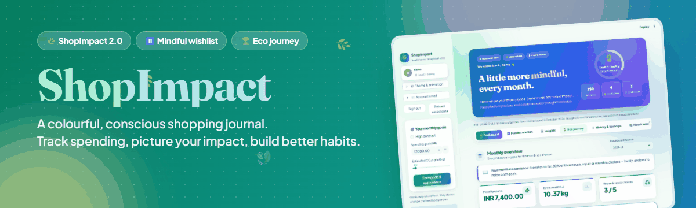
</p>

<p align="center">
  <strong>Understand your shopping. Pause before you buy. Celebrate every thoughtful choice.</strong><br>
  A Python + Streamlit app for purchase tracking, monthly goals, estimated environmental impact and mindful habits.
</p>

<p align="center">
  <a href="https://shopimpact-duy7hphexgoshhqfexfmkt.streamlit.app/">Open live app</a> ·
  <a href="output/presentation/ShopImpact_Vibrant_Deck.pptx">Download the presentation</a> ·
  <a href="https://canva.link/v8iiqeb2k0bxb1g">Open the Canva deck (21 slides)</a> ·
  <a href="#whats-new-in-shopimpact-20">What's new</a> ·
  <a href="#features">Explore features</a> ·
  <a href="#screenshots">See the app</a> ·
  <a href="#run-in-vs-code">Run locally</a> ·
  <a href="output/pdf/ShopImpact_10_Page_Explanation.pdf">Read the 10-page guide</a>
</p>

<p align="center">
  <a href="https://github.com/kavin-beep/ShopImpact-KavinK-1000527/actions/workflows/tests.yml"></a>
</p>

<p align="center"><sub>Prefer a still image? <a href="assets/readme/shopimpact-banner-static.png">View the static banner</a>.</sub></p>

| Built with | Persistence | Checks | Release status |
| :---: | :---: | :---: | :---: |
| Python 3.12 · Streamlit · Altair | SQLite / Neon PostgreSQL | 94 tests passed locally · 11 Nov 2026 | Live on Streamlit Cloud |

ShopImpact turns a purchase list into a colourful habit journal: record what you buy, see spending patterns, picture your rough emissions estimate, pause before buying, and celebrate reuse and repair. It implements **Scenario 1** of the Year 1 Python Programming assessment.

> **An estimate, with a clear purpose.** CO₂e means carbon dioxide equivalent. ShopImpact estimates impact using price × category factor; it does not measure a specific product's actual emissions.

---

## What's new in ShopImpact 2.0

Released 11 November 2026.

| | |
| :--- | :--- |
| 🎨 **Aurora design system** | Gradient hero with a level orb, glass cards, colourful KPI tiles, a new type scale (Plus Jakarta Sans + Fraunces) and refreshed Normal, Day and Night themes. |
| ✨ **Motion everywhere** | Cards rise in, numbers count up, goal rings draw themselves, badges pop, buttons shimmer and leaves drift. One switch (or the device's reduced-motion setting, or high contrast) turns it all off. |
| ⏸️ **Mindful wishlist** | Park something you want for a 7-day cool-off, then skip it (balloons, +25 eco points, money "kept in your pocket") or buy it (it becomes a purchase with a fresh estimate). |
| 🏆 **Eco journey** | Eco points, five levels from Seedling to Forest keeper, a reuse & repair streak and seven lifetime milestones. Points never change the fixed badge rules. |
| 🌍 **Everyday equivalents** | Each month's estimated kg CO₂e is pictured as car kilometres, smartphone charges and tree-months using US EPA equivalency factors. |
| 🍩 **Vibrant charts** | Rounded category bars, donuts and a gradient six-month trend built with Altair, plus a month-in-a-sentence summary. |

Two matching presentations cover the whole app: the 21-slide [Canva deck](https://canva.link/v8iiqeb2k0bxb1g) (updated for 2.0, with speaker notes) and an 18-slide PowerPoint, [`ShopImpact_Vibrant_Deck.pptx`](output/presentation/ShopImpact_Vibrant_Deck.pptx).

## Features

| Your shopping journal | Your bigger picture | Your next thoughtful choice |
| :--- | :--- | :--- |
| Log, find, edit and back up purchases | Track spending, estimated CO₂e and six-month trends | Pause on the mindful wishlist and explore alternatives |
| Separate accounts and saved preferences | Goal rings, category donuts and everyday equivalents | Earn eco points, levels, milestones and badges |

<details>
<summary><strong>View the complete feature list</strong></summary>

- Registration with email, email-or-username/password sign-in, sign-out and recovery-code password reset.
- Existing accounts can add or change their sign-in email after confirming their current password.
- Private purchase histories and settings saved across restarts.
- Product type (with icons), brand/shop, price and date input with a live estimate preview, reuse/new tag and everyday equivalent.
- Month/year dashboard with a month-in-a-sentence summary, spending, estimated kg CO₂e, category bars and donut, and animated goal rings.
- Vibrant aurora interface: gradient hero with level orb and counting stats, glass cards, colourful KPI tiles, animated aurora sign-in panel and responsive layouts.
- Everyday equivalents: car kilometres, smartphone charges and tree-months for each month's estimate.
- Mindful wishlist with a 7-day cool-off, skip/buy decisions, "kept in your pocket" and "estimated CO₂e not added" totals.
- Eco journey: eco points, five levels, a reuse & repair streak and seven lifetime milestones.
- Six-month Insights with a gradient trend chart, category mix donut, average purchase, goal balance and previous-calendar-month comparison.
- Eco Saver, Low Impact Shopper and Repair Champion achievements.
- Conditional Turtle artwork, rotating tips, Normal/Day/Night themes, a motion switch and high contrast.
- Category alternatives, named reuse/repair options with official links, and price-based comparison with visible assumptions.
- Search, month/category filters, date/price/impact sorting, an impact progress column, filtered CSV downloads, editing, deletion and JSON backup/restore.
- Confirmed account deletion and protection against conflicting edits in multiple tabs.

</details>

## Screenshots

A look inside ShopImpact 2.0. Screenshots use fictional purchases in an isolated local test account.

| A welcoming start | Your monthly overview |
| :---: | :---: |
|  | 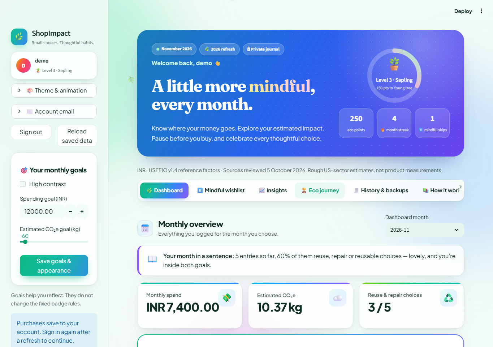 |
| **Charts, goal rings and achievements** | **Spending patterns over time** |
| 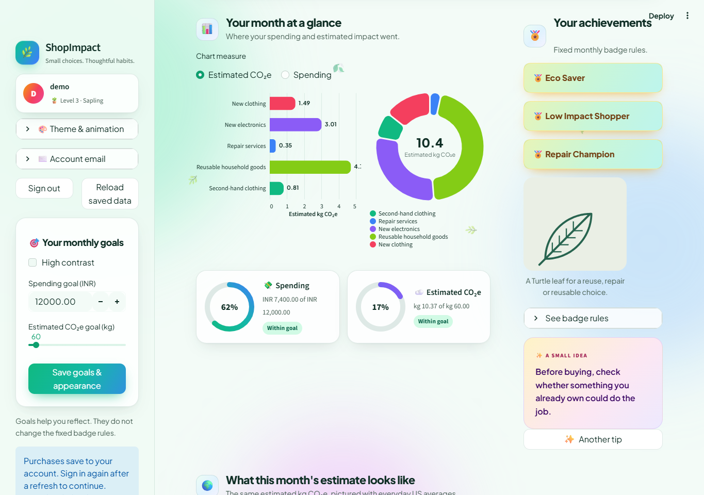 | 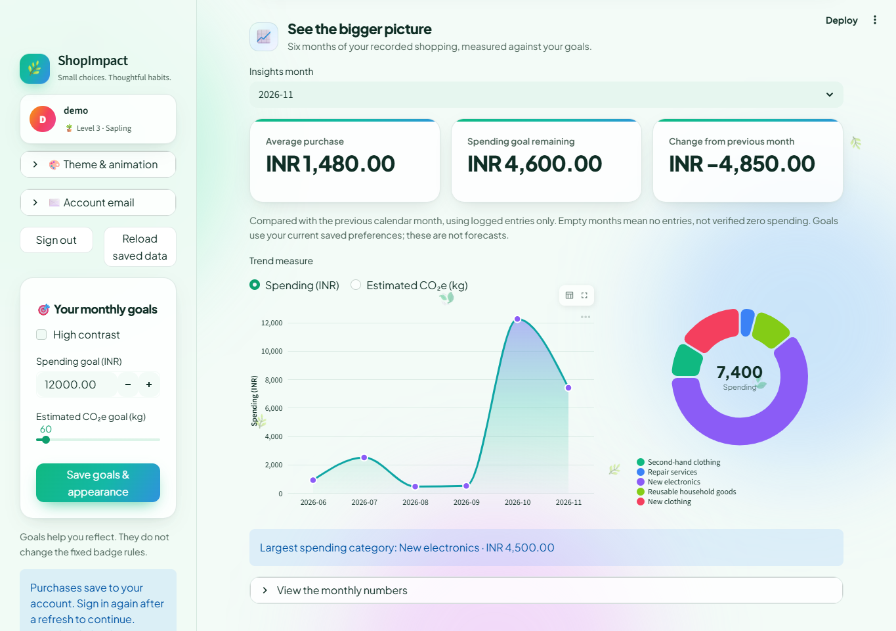 |
| **Pause before you buy** | **Your eco journey** |
| 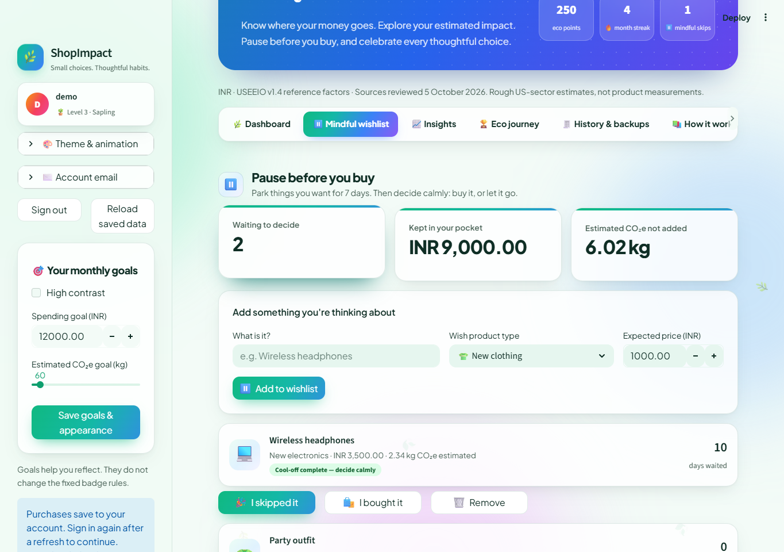 | 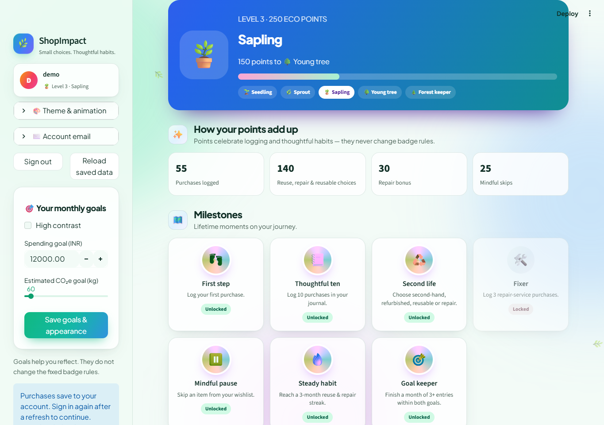 |

<details>
<summary><strong>Mobile, purchase history, Night theme and high contrast</strong></summary>

| Mobile sign-in | Mobile dashboard |
| :---: | :---: |
| 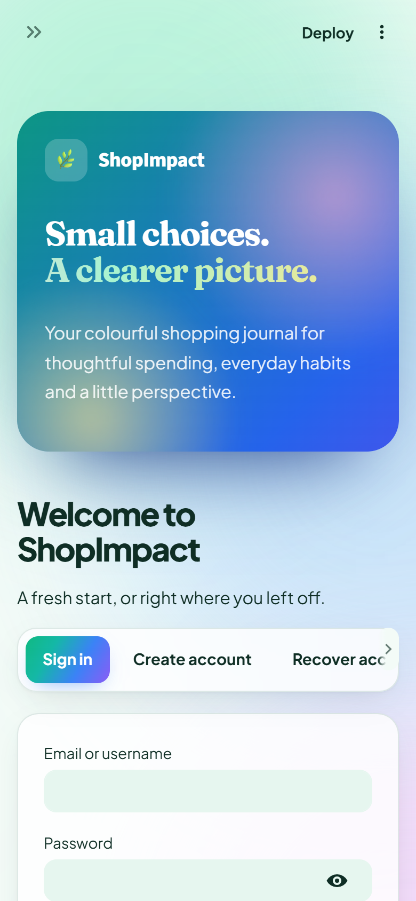 | 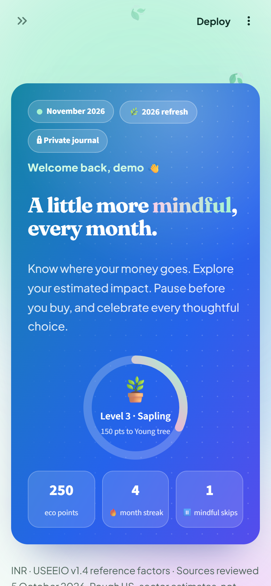 |

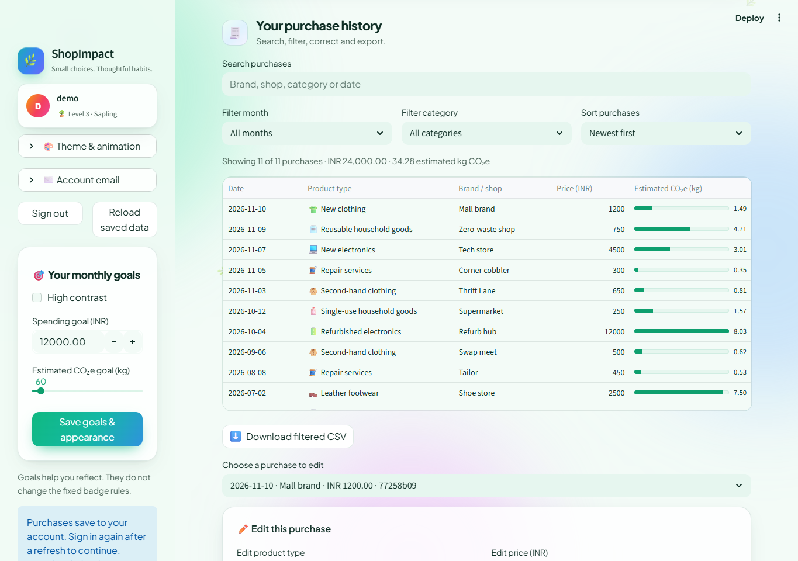

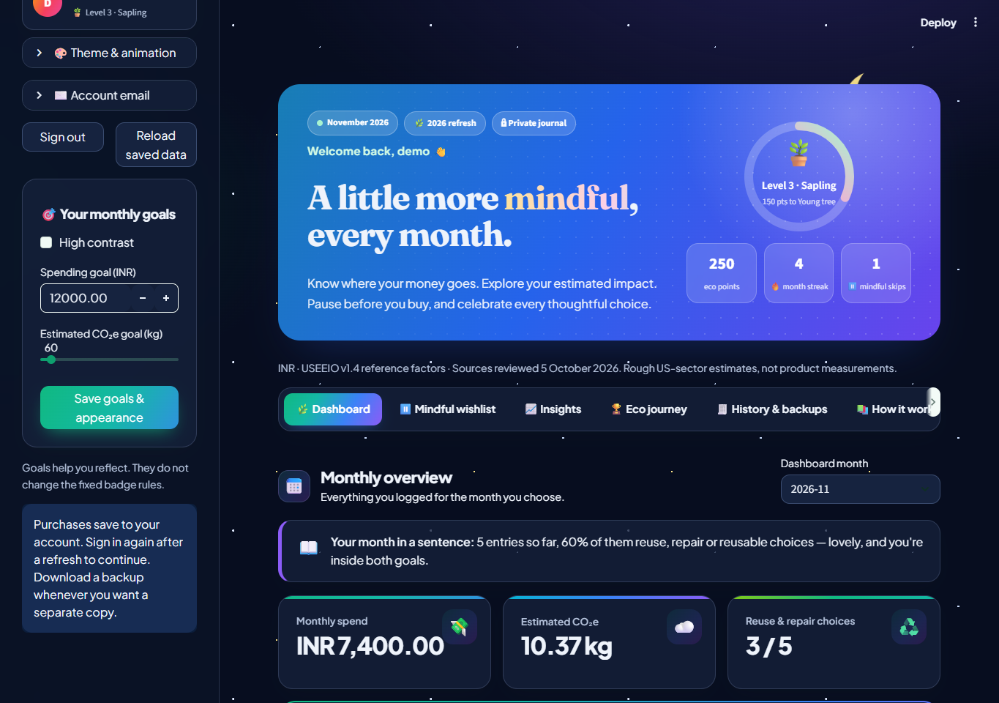

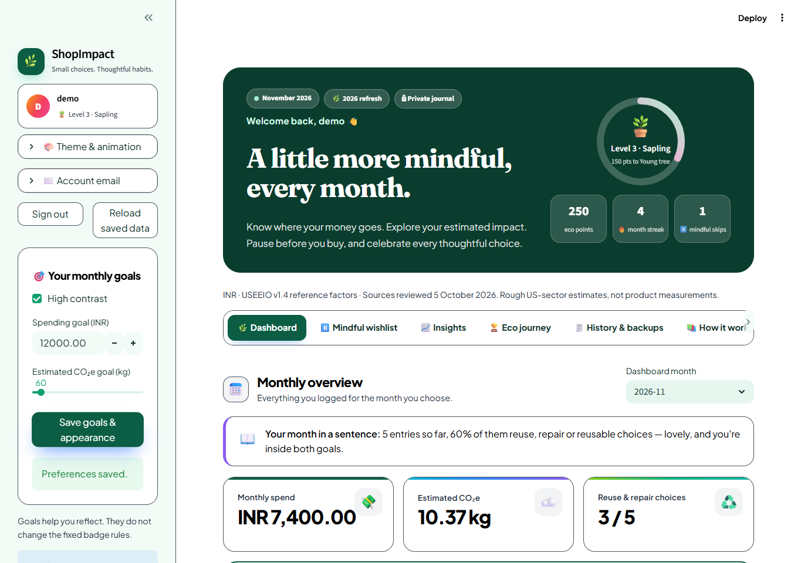

</details>

## Run in VS Code

Clone the repository, open the folder in VS Code and run these commands in its PowerShell terminal:

```powershell
git clone https://github.com/kavin-beep/ShopImpact-KavinK-1000527.git
cd ShopImpact-KavinK-1000527
py -3.12 -m venv .venv
.\.venv\Scripts\python.exe -m pip install -r requirements.txt --no-cache-dir
.\.venv\Scripts\python.exe -m streamlit run app.py --server.address 127.0.0.1
```

VS Code tasks and the Run ShopImpact debug configuration are included. Debugging requires Microsoft's Python and Python Debugger extensions.

Open the URL printed in the terminal, normally http://localhost:8501. Create your own account, save the recovery code privately, and sign in. Accounts start empty; no demo purchases are loaded. Closing or refreshing the page signs you out but does not delete saved purchases. Sessions expire after 12 hours.

## Data and calculations

The 2026 refresh uses final USEEIO Supply Chain GHG Emission Factors v1.4.0, published in October 2025 by the Cornerstone Sustainability Data Initiative, with IPCC AR6 warming potentials and 2024 USD prices. INR factors use the matching World Bank 2024 annual-average exchange rate. Values, source rows, category mappings and source URLs are included in `data/emission_sources.json` and `data/product_catalog.json`.

Everyday equivalents divide the estimate by US EPA Greenhouse Gas Equivalencies Calculator factors (page updated 4 August 2026): 3.93 × 10⁻⁴ t CO₂e per average petrol-car mile, 1.24 × 10⁻⁵ t CO₂ per smartphone charge and 0.060 t CO₂ per urban tree seedling per year. Values and derivations are in `data/equivalents.json`. They picture the estimate; they are not measurements, offsets or savings.

These are **rough reference estimates**. US sector averages, broad category mappings, a fixed historical exchange rate and unadjusted current prices are not a validated India-specific product footprint. New and reused versions use the same underlying factor; no unsupported reuse discount is invented. Read [current methodology and migration policy](docs/2026-update.md). Existing purchases keep their stored estimates until explicitly recalculated in How it works.

## Files and integration

| File | Responsibility |
| --- | --- |
| app.py | Shopping interface, dashboard, wishlist, insights, journey, history and backups |
| account_ui.py | Account screens and authenticated save flow |
| accounts.py | Argon2id passwords, sessions, recovery and database storage |
| logic.py | Decimal calculations, purchase dictionaries, monthly summaries, badge rules |
| insights.py | Six-month trends, goal balance and filtered history views |
| journey.py | Eco points, levels, streaks, milestones, equivalents and the mindful wishlist |
| ui.py | Design system, animations, themes and small HTML components |
| charts.py | Vibrant Altair category bars, donuts and trend areas |
| storage.py | Validated JSON import/export and spreadsheet-safe CSV |
| data/ | Product catalog, published source evidence, EPA equivalents and tips |
| tools/draw_rewards.py | Turtle leaf generation and optional desktop preview |
| tests/ | Disposable account/UI tests, journey tests and synthetic purchase fixtures |
| docs/ | Design, methodology, test evidence, deployment and assessment checklist |
| output/ | 10-page guide (PDF) and the PowerPoint presentation (PPTX); the Canva deck is linked above |

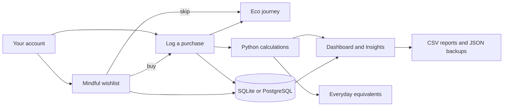

## Storage and privacy

Without hosted settings, accounts are stored in `personal_data/shopimpact.db`, excluded from Git. This workspace is now configured to use Neon PostgreSQL through private settings. Local SQLite accounts are not automatically migrated; export purchases before switching and restore them into a hosted account if needed. Each account has isolated purchases and settings. Passwords use salted Argon2id hashes; session and recovery tokens are stored as hashes. Five failed login/recovery attempts block that identifier for 15 minutes. Recovery rotates the code and revokes previous sessions. The database administrator can access purchase data; it is not end-to-end encrypted.

Purchases save automatically on successful add/edit/delete/restore. Wishlist items save automatically in the account's settings, alongside goals; skipped items never become purchases. Goals and appearance save through their labelled button. Purchase JSON backups exclude credentials, sessions, settings and the wishlist. Imports support 1,000 records and 2 MB. Legacy illustrative backups require an explicit migration checkbox and have estimates recalculated. Downloaded backups remain on your computer after account deletion.

New registrations require a unique email address. Existing accounts keep their usernames, passwords and purchases after additive migrations. Add an email in the sidebar's **Account email** panel. Email matching ignores case; username and email sign-in share the account's failed-attempt counter.

Creating an account automatically signs the user in and opens the home dashboard. The sign-in page contains Sign in, Create account and Recover account tabs. The recovery code can be saved from an expandable panel on the home page.

Email verification and password-reset links are implemented. Gmail delivery is awaiting private sender setup; use the [Gmail setup guide](docs/email-setup.md). Verification is optional for dashboard access and available from the sidebar's Account email panel; a verified address is required for email password-reset links. Links expire, can be used once and are invalidated by relevant account changes. Resetting a password signs out existing sessions and replaces the recovery code. Google OAuth sign-in is not implemented.

## Turtle

```powershell
.\.venv\Scripts\python.exe tools/draw_rewards.py
.\.venv\Scripts\python.exe tools/draw_rewards.py --preview
```

The default command uses `turtle.TNavigator` with an SVG pen adapter. The optional preview uses `turtle.Turtle` and requires working Tk. The app displays the generated SVG when a qualifying choice exists; it is not a live browser Turtle animation. Desktop preview remains unverified in the bundled runtime. Confirm assessment acceptance of the SVG integration.

### Appearance themes

Open **Theme & animation** in the sidebar to choose **Normal** (a fresh aurora of mint, sky and lilac with drifting leaves), **Day** (a glowing sun, drifting clouds and leaves) or **Night** (a deep navy sky, crescent moon and falling stars). Choices apply to the current browser session, including sign-in. Turn off **Animated scenery** to stop both the background scenery and interface animations such as rising cards, counting numbers and drawing goal rings. Device reduced-motion settings pause the scenery, and high contrast hides it and removes all animation.

## Verification

```powershell
.\.venv\Scripts\python.exe -m unittest discover -s tests -v
```

94 automated tests pass (11 November 2026), covering calculations, the eco journey, the mindful wishlist, everyday equivalents, factor provenance, account isolation, persistence, recovery, rate limiting, concurrent saves, trends, filtering and interface workflows. Tests use disposable databases and do not write to real accounts. The 15-purchase synthetic fixture exists only for testing. See [test evidence](docs/testing.md).

## Deployment and assessment

The [repository readiness review](docs/repository-readiness.md) records the final checks and remaining launch/submission work. Invalid optional email settings now leave sign-in, shopping and recovery-code access available; email reset buttons remain disabled until valid settings are provided.

The [ten-page code and data guide](output/pdf/ShopImpact_10_Page_Explanation.pdf) is included for learning and review. Its test count describes the earlier 78-test snapshot; the current suite has 94 tests. The guide predates the ShopImpact 2.0 design, the wishlist, the eco journey and the v3 reference data; see this README and the 2026 update for the current version. It is separate from the final assessment submission document.

The [Canva deck](https://canva.link/v8iiqeb2k0bxb1g) (21 slides) and the [PowerPoint presentation](output/presentation/ShopImpact_Vibrant_Deck.pptx) (18 slides) cover the problem, the estimate model, every feature of ShopImpact 2.0 and the test results. Its screenshots and six-month chart use the same fictional local test account as the README screenshots.

See [deployment instructions](docs/deployment.md). Neon PostgreSQL was connected and verified on 2 October 2026: registration, login, account isolation, purchase persistence across new connections, conflicting-save protection and logout passed. Temporary QA accounts were deleted. ShopImpact is deployed on Streamlit Community Cloud, and the public sign-in page has been checked in the browser. Full account workflows on the deployed app, redeployment persistence and provider backup restoration remain pending verification.

Start hosted database setup with the [Neon walkthrough](docs/neon-setup.md) and private terminal helper.

Public app: [Open ShopImpact](https://shopimpact-duy7hphexgoshhqfexfmkt.streamlit.app/).

GitHub repository: [kavin-beep/ShopImpact-KavinK-1000527](https://github.com/kavin-beep/ShopImpact-KavinK-1000527).

Real participant feedback, assessor access and the final submission PDF remain pending. See [requirements](docs/requirements.md) and [feedback template](docs/usability-feedback.md). Screenshots use an isolated local test account and fictional input, not a preloaded demo workspace.

## Testing

| Test file | What it checks |
| --- | --- |
| [tests/test_logic.py](tests/test_logic.py) | Decimal rounding, price and date validation, factor provenance, summaries and badge rules |
| [tests/test_insights.py](tests/test_insights.py) | Six-month trends, month shifting, goal balance and history filters |
| [tests/test_journey.py](tests/test_journey.py) | Eco points, levels, streaks, milestones, EPA equivalents and the wishlist lifecycle |
| [tests/test_accounts.py](tests/test_accounts.py), [tests/test_account_service.py](tests/test_account_service.py) | Registration, hashing, isolation, recovery, rate limiting and conflicting saves |
| [tests/test_app.py](tests/test_app.py) | Real Streamlit interface flows: sign-in, themes, add/edit/delete, insights, wishlist skip/buy and backups |
| [tests/test_email_actions.py](tests/test_email_actions.py), [tests/test_email_delivery.py](tests/test_email_delivery.py) | Verification and reset links, and safe email delivery |
| [tests/test_database_setup.py](tests/test_database_setup.py) | Hosted database configuration helpers |

Every push and pull request runs the full suite on GitHub Actions (see the badge above).

## References

- [USEEIO v1.4 published dataset](https://zenodo.org/records/17202747)
- [World Bank 2024 INR exchange rate](https://api.worldbank.org/v2/country/IND/indicator/PA.NUS.FCRF?date=2024&format=json)
- [US EPA Greenhouse Gas Equivalencies Calculator — calculations and references](https://www.epa.gov/energy/greenhouse-gas-equivalencies-calculator-calculations-and-references)
- [Streamlit database guidance](https://docs.streamlit.io/develop/concepts/connections/connecting-to-data)
- [Vega-Altair charts](https://altair-viz.github.io/)
- [Python Turtle](https://docs.python.org/3/library/turtle.html)
- [OWASP password storage](https://cheatsheetseries.owasp.org/cheatsheets/Password_Storage_Cheat_Sheet.html)

## Credits

- Name: Kavin K
- Grade: IBCP Y1
- Name of Mentor: Syed Ali Beema S
- Registration No: 1000527
- Name of School: Jain Vidyalaya
- AI assistance: OpenAI ChatGPT (Codex) assisted with coding, debugging and documentation; Anthropic Claude assisted with the ShopImpact 2.0 redesign, new features and presentations. Project direction and final decisions were made by the student.
