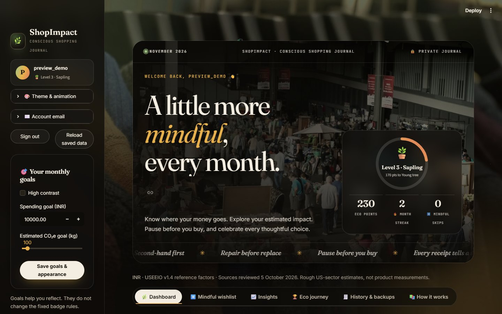
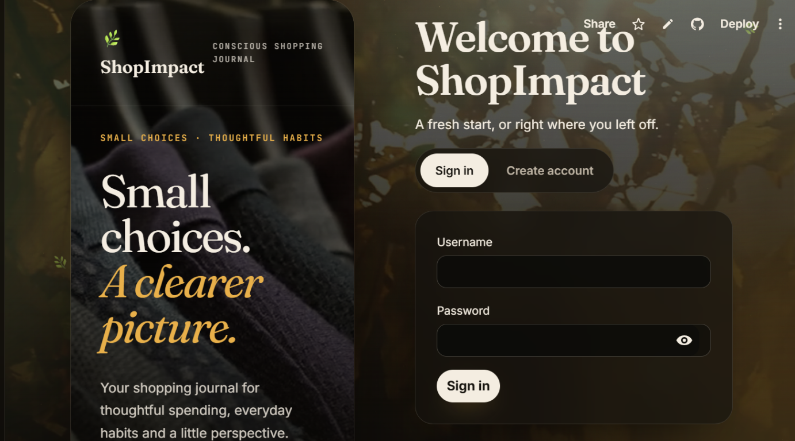
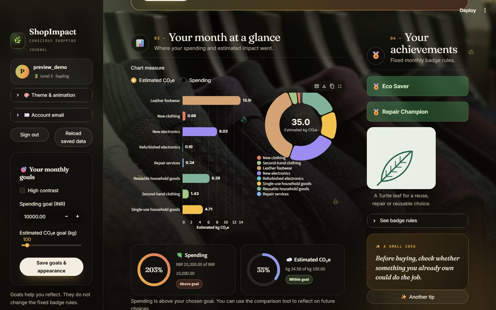
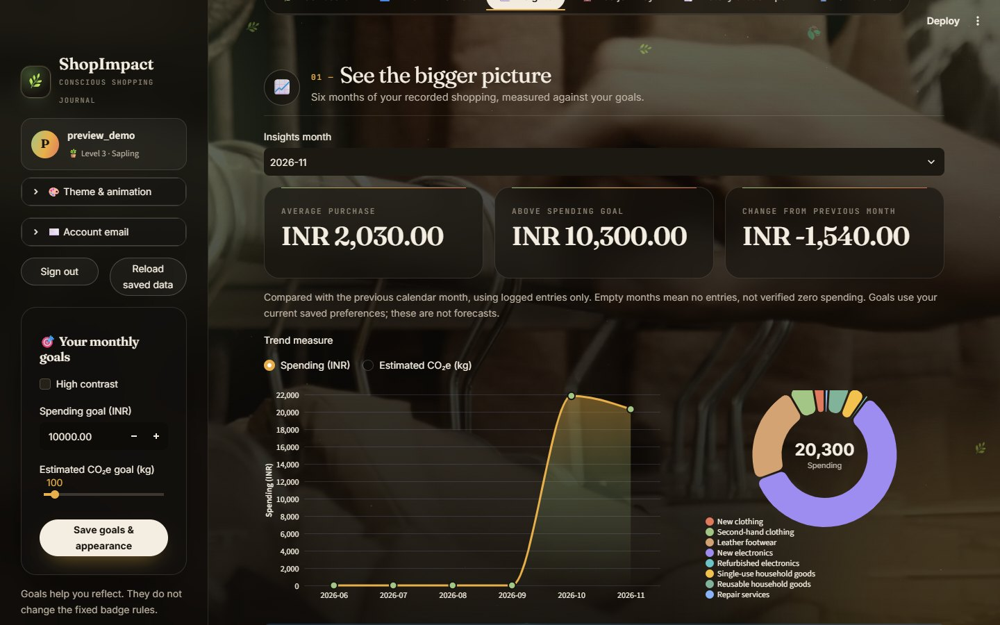
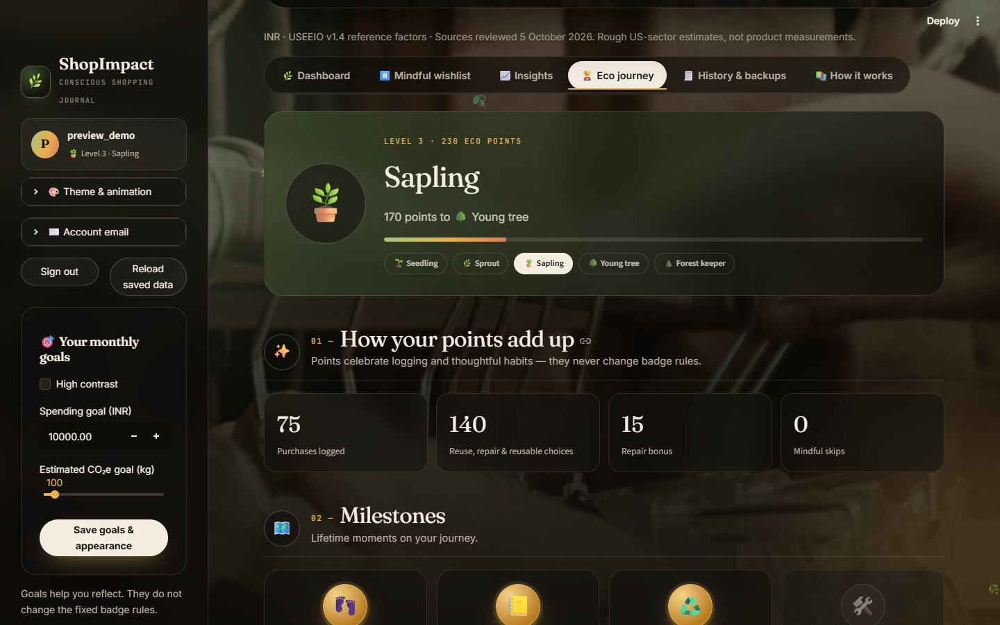
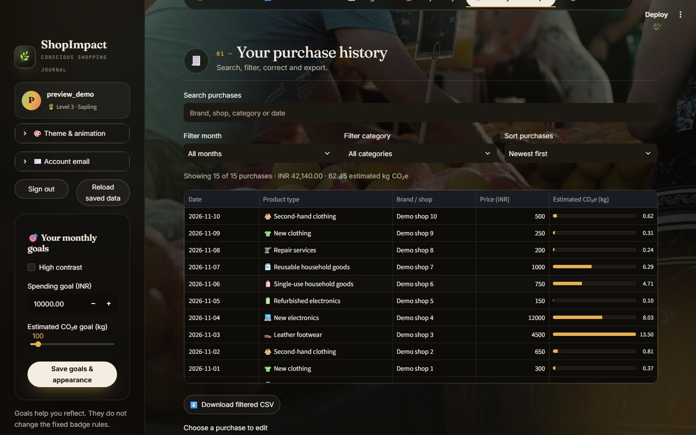
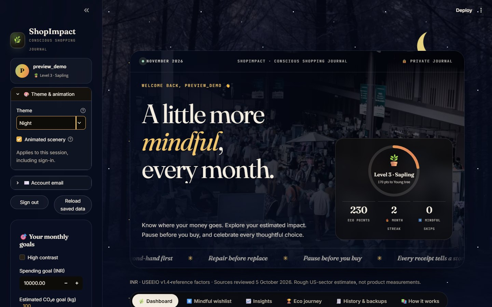
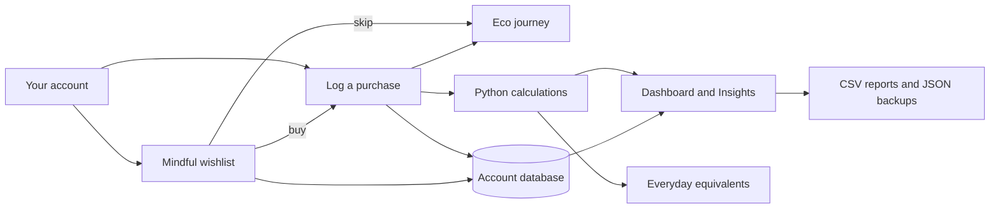

<div align="center">


<a href="https://shopimpact-duy7hphexgoshhqfexfmkt.streamlit.app/">
  
</a>

<p>
  <a href="https://shopimpact-duy7hphexgoshhqfexfmkt.streamlit.app/"></a>
</p>

<p>
  <a href="https://github.com/kavin-beep/IDAI102_1000527_ShopImpactAI_Kavin-K/actions/workflows/tests.yml"></a>
  
  
  
  
  
  
</p>

**🌐 Live app → [shopimpact.streamlit.app](https://idai1021000527shopimpactaikavin-k-dt4pcaipehuzgmnvp9gr4b.streamlit.app/)**

<sub>
<a href="https://canva.link/v8iiqeb2k0bxb1g">**CANVA LINK**</a> ·
</sub>

</div>

---

## 🔐 Sign in to ShopImpact

Sign in with a username and password, or create a new account. No email address or password recovery flow is shown.
Account data is saved in the configured database.

---

## 🛍️ What is ShopImpact?

**ShopImpact** turns a purchase list into a calm, cinematic habit journal. You record what you buy, see where your money
goes, picture a rough emissions estimate, pause before buying, and celebrate reuse and repair. It implements
**Scenario 1** of the Year 1 Python Programming assessment.

### Problem statement

People can find it difficult to understand the possible environmental impact of everyday purchases, the money they
spend over time, and which lower-impact alternatives are practical. ShopImpact presents these ideas in a simple,
private shopping journal without pretending that rough estimates are exact product measurements.

### Objectives

- Record purchases, edit or delete them, and review monthly spending and estimated impact.
- Explain broad category estimates and everyday equivalents clearly.
- Encourage reuse, repair and a mindful 7-day wishlist without guilt.
- Provide persistent username accounts with usable export, import and backup tools.
- Verify the implementation with automated tests and documented screenshots.

### Target users

ShopImpact is designed for students, young adults and families who want a plain-language overview of shopping habits.
It is intended for people with no specialist carbon-accounting knowledge and may be used on desktop or a narrow
mobile screen.

> **An estimate, with a clear purpose.** CO₂e means carbon dioxide equivalent. ShopImpact estimates impact as
> **price × category factor**. It does not measure a specific product's actual emissions.

| Built with | Account data | Checks | Release status |
| :---: | :---: | :---: | :---: |
| Python 3.12 · Streamlit · Altair | SQLite locally · PostgreSQL hosted | Automated tests · 26 Nov 2026 | Live on Streamlit Cloud |

---

## ✨ Highlights

### 🎨 Cinematic "Conscious Market Journal" design
- **Living background:** slow crossfades between second-hand market, clothes-rack, produce-stall and forest footage, with film grain and warm WebGL bokeh. It is injected once into the page, so it keeps looping across every click; a watchdog restarts stalled clips and a still gradient sits underneath, so the screen never goes black.
- **Video hero:** a masked serif headline ("A little more *mindful*, every month."), a level orb that draws itself, counting stats and a scrolling ticker of habits.
- **Editorial details:** dark glass panels, Fraunces serif headlines, mono kickers, numbered section headings, a pill tab index, gentle 3D card tilt and an earthy chart palette.
- **Themes for every mood:** **Normal** (natural footage), **Day** (warm golden grade with sun and clouds) and **Night** (blue-graded footage, crescent moon and falling stars).
- **Respectful motion:** turning off *Animated scenery*, or the device's reduced-motion setting, removes the video and animations. **High contrast** switches to black, white and yellow with no footage.

### 🧾 A shopping journal you can trust
- Product type (with icons), brand or shop, price and date, plus a **live receipt-style estimate** that shows the kg CO₂e, a reuse/new tag and an everyday equivalent as you type.
- A month dashboard with a **month-in-a-sentence** summary, spending, estimated kg CO₂e, category bars and donut, and animated **goal rings**.
- Search, month and category filters, sorting by date, price or impact, editing, deletion, filtered CSV downloads and JSON backup and restore.

### ⏸️ Habits, not guilt
- **Mindful wishlist:** park something for a 7-day cool-off, then skip it (+25 eco points, money "kept in your pocket") or buy it (it becomes a purchase with a fresh estimate).
- **Eco journey:** eco points, five levels from *Seedling* to *Forest keeper*, a reuse and repair streak and seven lifetime milestones. Points never change the fixed badge rules.
- **Everyday equivalents:** each month's estimate pictured as car kilometres, smartphone charges and tree-months using US EPA factors.
- **Ideas before buying:** category alternatives, named reuse and repair options with official links, rotating tips and a Turtle-drawn leaf reward.
- **Plant pal:** a cute animated plant shares gentle tips, wiggles its leaves on hover, looks happy when estimates are within the CO₂e goal, and wilts when spending goes over budget.

### 🔐 Username accounts
- Sign in with a username and password, or create an account. No email address or password recovery flow is shown.
- New passwords may contain 1–8 characters. Passwords are stored as salted Argon2id hashes, not plaintext.
- Purchases, wishlist items and preferences are saved to the account database so they are available after signing in again.

---

## 🖼️ Screens

<table>
  <tr>
    <td width="50%"><br/><sub><b>Home</b> — video hero, level orb, counting stats</sub></td>
    <td width="50%"><br/><sub><b>Sign in</b> — username and password, with Create account</sub></td>
  </tr>
  <tr>
    <td><br/><sub><b>Add a purchase</b> — KPIs and a live receipt-style estimate</sub></td>
    <td><br/><sub><b>Your month at a glance</b> — bars, donut and badges</sub></td>
  </tr>
  <tr>
    <td><br/><sub><b>Equivalents and alternatives</b> — car km, phone charges, tree-months</sub></td>
    <td><br/><sub><b>Mindful wishlist</b> — 7-day cool-off, skip or buy</sub></td>
  </tr>
  <tr>
    <td><br/><sub><b>Insights</b> — six-month trend and category mix</sub></td>
    <td><br/><sub><b>Eco journey</b> — level, points, milestones</sub></td>
  </tr>
  <tr>
    <td><br/><sub><b>History and backups</b> — search, filter, export</sub></td>
    <td><br/><sub><b>Night theme</b> — moon, stars, blue-graded footage</sub></td>
  </tr>
</table>

<sub>Other account-flow images are historical and may show former email/recovery controls. No real user data is shown.</sub>

---

## ⚙️ How it works

<div align="center"></div>



### 📐 Data and calculations

- **Emission factors:** final **USEEIO Supply Chain GHG Emission Factors v1.4.0** (Cornerstone Sustainability Data Initiative, October 2025), IPCC AR6 warming potentials and 2024 USD prices. INR factors use the World Bank 2024 annual-average exchange rate. Values, source rows, mappings and URLs live in `data/emission_sources.json` and `data/product_catalog.json`.
- **Everyday equivalents:** US EPA Greenhouse Gas Equivalencies Calculator factors (page updated 4 August 2026): 3.93 × 10⁻⁴ t CO₂e per average petrol-car mile, 1.24 × 10⁻⁵ t CO₂ per smartphone charge and 0.060 t CO₂ per urban tree seedling per year (`data/equivalents.json`). They picture the estimate; they are not measurements, offsets or savings.
- **Honest limits:** these are **rough reference estimates**. US sector averages, broad category mappings, a fixed historical exchange rate and unadjusted prices are not a validated India-specific footprint. New and reused versions use the same factor; no unsupported reuse discount is invented. See the [methodology and migration policy](docs/2026-update.md). Existing purchases keep their stored estimates until recalculated in *How it works*.

---

## 🧭 Pages

| Tab | What you do there |
| --- | --- |
| 🌿 **Dashboard** | Pick a month, read the month in a sentence, add a purchase, see charts, goal rings, badges, equivalents and alternatives |
| ⏸️ **Mindful wishlist** | Park a want for 7 days, then skip it or buy it |
| 📈 **Insights** | Six-month trend, category mix, average purchase, goal balance and change from the previous month |
| 🏆 **Eco journey** | Level, eco points breakdown, lifetime milestones and monthly badges |
| 🧾 **History & backups** | Search, filter, sort, edit, delete, export CSV, and back up or restore JSON |
| 📚 **How it works** | Assumptions, factor table, privacy notes and estimate recalculation |

The sidebar holds account controls, **Theme & animation**, saved monthly spending and CO₂e goals, and high contrast.

---

## 🚀 Run it locally

Clone the repository, open the folder in VS Code and run these in its PowerShell terminal:

```powershell
git clone https://github.com/kavin-beep/IDAI102_1000527_ShopImpactAI_Kavin-K.git
cd IDAI102_1000527_ShopImpactAI_Kavin-K
py -3.12 -m venv .venv
.\.venv\Scripts\python.exe -m pip install -r requirements.txt --no-cache-dir
.\.venv\Scripts\python.exe -m streamlit run app.py --server.address 127.0.0.1
```

Open the URL printed in the terminal (normally http://localhost:8501). Create an account with a username and password
of up to 8 characters, then sign in again any time to access saved purchases. Local data is stored in
`personal_data/shopimpact.db`. VS Code tasks and a *Run ShopImpact* debug configuration are included (they need
Microsoft's Python and Python Debugger extensions).

**Turtle reward artwork**

```powershell
.\.venv\Scripts\python.exe tools/draw_rewards.py
.\.venv\Scripts\python.exe tools/draw_rewards.py --preview
```

The default command uses `turtle.TNavigator` with an SVG pen adapter. `--preview` uses `turtle.Turtle` and needs a
working Tk. The app shows the generated SVG when a qualifying choice exists; it is not a live browser Turtle animation.

---

## ☁️ Deploy on Streamlit Community Cloud

1. Push this repository to GitHub and create an app on [share.streamlit.io](https://share.streamlit.io) with `app.py` as the entry point.
2. Configure `SHOPIMPACT_PUBLIC = true` and `SHOPIMPACT_DATABASE_URL` with a persistent PostgreSQL database in the app's private Secrets. See [deployment instructions](docs/deployment.md).
3. Without hosted database configuration, the app uses local SQLite, which is not guaranteed to persist on hosted instances.

---

## 🔒 Storage and privacy

- Account passwords are stored as salted Argon2id hashes. The UI offers username sign-in and account creation only; it has no email or password recovery option.
- Purchases, wishlist items and preferences are saved per account in SQLite locally or PostgreSQL when hosted. Configure a persistent hosted database to retain data through deployments and restarts.
- JSON backups contain purchase records, not account credentials. Do not share backup files.

---

## 🧪 Testing

```powershell
.\.venv\Scripts\python.exe -m unittest discover -s tests -v
```

89 automated tests pass (26 November 2026), and every push and pull request runs the suite on GitHub Actions. Tests use disposable data and do not write to real users. See [test evidence](docs/testing.md).

| Test file | What it checks |
| --- | --- |
| [tests/test_logic.py](tests/test_logic.py) | Decimal rounding, price and date validation, factor provenance, summaries and badge rules |
| [tests/test_insights.py](tests/test_insights.py) | Six-month trends, month shifting, goal balance and history filters |
| [tests/test_journey.py](tests/test_journey.py) | Eco points, levels, streaks, milestones, EPA equivalents and the wishlist lifecycle |
| [tests/test_accounts.py](tests/test_accounts.py) | Hashed passwords, rate limiting, account isolation and persistent saves |
| [tests/test_app.py](tests/test_app.py) | Streamlit flows: username sign-in, account creation, persistent login, themes, purchases, insights and wishlist |
| [tests/test_email_actions.py](tests/test_email_actions.py), [tests/test_email_delivery.py](tests/test_email_delivery.py) | Legacy email service tests; email is not part of the account UI |
| [tests/test_database_setup.py](tests/test_database_setup.py) | Hosted database configuration helpers |

---
## User Feedback
No.	Respondent	Date	Feedback
1	Friend 1	November 3, 2026	I found the purchase tracking feature really useful. The monthly dashboard makes it easier to understand where my money goes. I would like to see more product categories added.
2	Mother	November 6, 2026	The application gives a good overview of our shopping habits and their estimated environmental impact. The 7-day wishlist is a thoughtful feature that encourages us to reconsider unnecessary purchases.
3	Friend 2	November 10, 2026	I liked the eco points and achievement system because it makes sustainable shopping more engaging. The interface looks attractive, although some features could have more guidance for first-time users.
4	Father	November 15, 2026	The monthly spending insights and charts are helpful. I particularly liked how the application connects spending habits with environmental awareness. Adding more region-specific product information could improve its accuracy.
5	Classmate	November 19, 2026	The application is creative and easy to navigate. The reuse and repair suggestions are useful, and the CO₂e equivalents make environmental impact easier to understand. I would recommend adding more alternative suggestions for different products.

---

## 🗂️ Project structure

```text
IDAI102_1000527_ShopImpactAI_Kavin-K/
├── app.py              # Dashboard, wishlist, insights, journey, history and backups
├── account_ui.py       # Username sign-in and account creation screens
├── accounts.py         # Argon2id passwords, sessions, rate limiting and database storage
├── logic.py            # Decimal calculations, purchases, monthly summaries, badge rules
├── insights.py         # Six-month trends, goal balance and filtered history views
├── journey.py          # Eco points, levels, streaks, milestones, equivalents, wishlist
├── ui.py               # Cinematic design system, background footage, themes, HTML components
├── charts.py           # Earthy Altair bars, donuts and trend areas
├── storage.py          # Validated JSON import/export and spreadsheet-safe CSV
├── email_delivery.py   # Legacy email helpers; not connected to the account UI
├── data/               # Product catalog, source evidence, EPA equivalents, tips, links
├── tools/              # Turtle leaf, database and email setup helpers
├── tests/              # App, account, logic and legacy service tests
├── docs/               # Design, methodology, testing, deployment; docs/media holds README art
└── output/             # 10-page guide (PDF) and PowerPoint presentation
```

---

## 🧰 Tech stack

| Layer | Tools |
| --- | --- |
| App | Python 3.12, Streamlit, Vega-Altair, pandas |
| Motion and design | CSS animation, Three.js (WebGL bokeh), Mixkit footage, Fraunces, Inter, JetBrains Mono |
| Data | USEEIO v1.4, World Bank 2024 INR rate, US EPA equivalencies |
| Accounts and storage | SQLAlchemy, Neon PostgreSQL or SQLite, argon2-cffi |
| Quality | unittest + Streamlit AppTest, GitHub Actions |

---

## 🎓 Assessment and presentations

- **Canva deck** (21 slides, with speaker notes): [canva.link/v8iiqeb2k0bxb1g](https://canva.link/v8iiqeb2k0bxb1g)
- **10-page code and data guide**: [`ShopImpact_10_Page_Explanation.pdf`](output/pdf/ShopImpact_10_Page_Explanation.pdf)

The PowerPoint deck and PDF guides are refreshed for the November 2026 account flow, plant pal and 89-test snapshot.
Five informal feedback responses from friends, family and a classmate are recorded in the User Feedback section
above. They are genuine comments, but they are not a structured task-based usability study. The
[reusable feedback template](docs/usability-feedback.md) can be used to collect more detailed observations.

---

## 📚 References

- [USEEIO v1.4 published dataset](https://zenodo.org/records/17202747)
- [World Bank 2024 INR exchange rate](https://api.worldbank.org/v2/country/IND/indicator/PA.NUS.FCRF?date=2024&format=json)
- [US EPA Greenhouse Gas Equivalencies Calculator — calculations and references](https://www.epa.gov/energy/greenhouse-gas-equivalencies-calculator-calculations-and-references)
- [Streamlit database guidance](https://docs.streamlit.io/develop/concepts/connections/connecting-to-data)
- [Vega-Altair charts](https://altair-viz.github.io/)
- [Python Turtle](https://docs.python.org/3/library/turtle.html)
- [OWASP password storage](https://cheatsheetseries.owasp.org/cheatsheets/Password_Storage_Cheat_Sheet.html)
- Background and cover footage: [Mixkit](https://mixkit.co/) free stock video licence

---

## 🙏 Credits

- Name: Kavin K
- Grade: IBCP Y1
- Name of Mentor: Syed Ali Beema S
- Registration No: 1000527
- Name of School: Jain Vidyalaya
- AI assistance: OpenAI ChatGPT (Codex) assisted with coding, debugging and documentation; Anthropic Claude assisted with the ShopImpact 2.0 redesign, the cinematic UI, new features and presentations. Project direction and final decisions were made by the student.

<div align="center"><sub>Small choices. A clearer picture. 🌿</sub></div>
